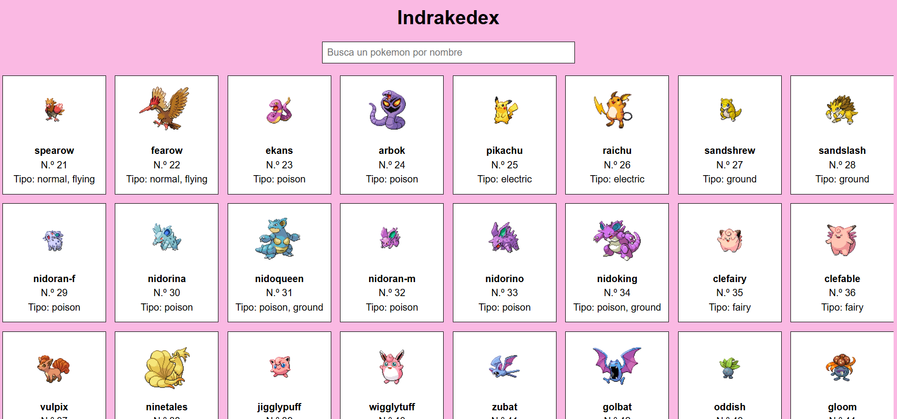

# IndraKedex

Web Pokedex developed with JavaScript that allows users to retrieve Pokemon information through an API.

## Main page



## Run Locally

1. Clone the repository:

```bash
git clone https://github.com/your-username/IndraKedex.git
```

2. Open the project folder:

```bash
cd IndraKedex
```

3. Start a local server:

```bash
python3 -m http.server 8000
```

4. Open your browser and visit:

```
http://localhost:8000
```
